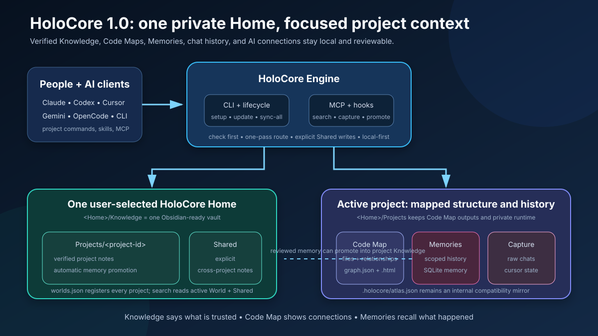
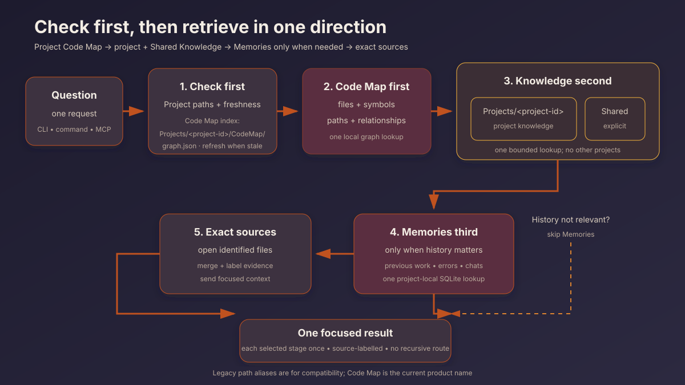

# Architecture and technical guide



## Runtime boundary

HoloCore is one Python package under `src/holocore`. Obsidian Second Brain, Graphify, and MemPalace served as behavioral references during the native rewrite; they are not imports, subprocesses, services, bundled runtimes, or prerequisites.

Version `0.5.0` separates shared durable knowledge from rebuildable and sensitive project state:

- One user-selected **HoloCore Home** is shared by all registered projects.
- `<Home>/Knowledge` is one Markdown vault that may be opened directly in Obsidian.
- `<Home>/Knowledge/Projects/<project-id>` stores durable knowledge for one project.
- `<Home>/Knowledge/Shared` stores durable knowledge intentionally shared across projects.
- HoloCore Home keeps each project's Code Map, Memories scope, capture cursors, and raw chats under `<Home>/Projects/<project-id>` and `<Home>/Memories`.

The Home contains a `worlds.json` registry. A small user-level pointer remembers the selected Home. World IDs combine a readable project slug with a short hash of the normalized project path, avoiding collisions between projects with the same folder name.

## Main components

- `cli.py`: command parsing, Home selection prompt, and human or JSON output.
- `home.py`: Home pointer, Archive layout, World IDs, registry, and safe legacy Markdown import.
- `config.py`: active World configuration and shared/local path resolution.
- `layout.py`: path reporting, onboarding text, and client health checks.
- `engine.py`: setup, search cache, automatic Code Map freshness, memory refinement, and Knowledge promotion.
- `router.py`: check-first, non-recursive route planning and ordered retrieval.
- `archive.py`: bounded Markdown operations plus an `ArchiveView` over the active World and `Shared`.
- `atlas.py`: incremental local structural extraction, graph queries, freshness, paths, and affected analysis.
- `memories.py`: shared SQLite project Memories, groups, provenance, deduplication, search, migrations, and sync.
- `memory_collection.py`: scoped collection from files, conversations, and Git history.
- `memory_retrieval.py`: lexical and optional semantic retrieval over a project scope.
- `animus.py`, `animus_mining.py`, and `animus_retrieval.py`: import-only v1 compatibility shims.
- `memory_pipeline.py`: raw-chat audit and one-pass local or OpenAI-compatible extraction.
- `capture.py`: incremental Claude/Codex transcript parsing and committed byte cursors.
- `capture_hook.py`: non-blocking hook entry point and post-capture Atlas freshness.
- `install.py`: non-destructive Home/World bootstrap, generated commands, MCP registration, and hooks.
- `lifecycle.py`: all-World reconciliation and Git-based self-update.
- `mcp_server.py`: local stdio MCP tools and prompts.

## Storage model

```text
<Home>/
├── Knowledge/
│   ├── system/index.md
│   ├── Shared/
│   │   └── wiki/
│   └── Projects/
│       └── <project-id>/
│           ├── Inbox/
│           ├── wiki/
│           │   └── memory/         Automatically promoted conversation knowledge
│           └── system/index.md
├── Projects/
│   └── <project-id>/
│       ├── CodeMap/
│       │   ├── graph.json
│       │   └── atlas.html          Legacy-compatible filename
│       ├── Runtime/
│       ├── Inbox/
│       ├── Sources/
│       └── world.json
├── Memories/
│   ├── animus.db                   Legacy-compatible database filename
│   └── ChatHistory/<project-id>/
├── Connections/
└── worlds.json
```

Code Maps remain project-scoped, while one shared Memories database keeps every record attached to its project. Knowledge is one vault so a person or AI client can navigate durable notes through a single visible root.

## Retrieval data flow

`CLI or MCP → readiness/freshness check → Code Map → project Knowledge + Shared → optional Memories → exact sources → labelled result`

For normal unified search, the engine checks the Code Map first and refreshes it if missing or stale. The router then:

1. Searches the Code Map once to identify files, symbols, and relationships.
2. Expands one Knowledge query with bounded Code Map hints.
3. Searches project and Shared Knowledge; results retain their scope.
4. Searches Memories once only when the question indicates previous work, errors, attempts, history, or conversations.
5. Returns source-labelled evidence so the AI can open exact sources.

A context-local recursion guard rejects a route that calls itself. Each selected subsystem executes at most once.



## Automatic capture and promotion

Setup merges these project hooks:

- Claude Code: `SessionEnd` in `<project>/.claude/settings.json`.
- Codex: `Stop` in `<project>/.codex/hooks.json`.

The hook receives the client payload, reads only transcript bytes after the last committed cursor, ignores tool/system/analysis records, removes adjacent duplicate messages, and calls the same refinement pipeline used by `ingest-chat`. The cursor advances only after ingestion succeeds, so a failed run can retry without losing content.

The pipeline writes a raw audit, stores deduplicated project-scoped Memories, and promotes useful extraction into:

`<Home>/Knowledge/Projects/<project-id>/wiki/memory/<date>-<digest>.md`

Promotion occurs when extraction contains facts or decisions, or a meaningful summary. The content digest gives deterministic deduplication. Promotion defaults to the active World; explicit paths beginning with `shared/` target `<Home>/Knowledge/Shared`.

Hook errors are converted to a result and do not block the AI client. After successful ingestion, the hook checks the Code Map and refreshes it when necessary.

## Setup, reconciliation, and update

`holocore setup` initializes the selected Home, registers the current World, resolves its Archive view, writes or merges client integrations, installs capture hooks, and builds Atlas. If a legacy `<project>/Archive` exists, Markdown is copied safely into the World's `Imported` folder; identical files are skipped and conflicts are not overwritten.

`holocore sync-all` walks the Home registry. For each available World it reruns non-destructive bootstrap and ensures Atlas is fresh. A missing project is reported as failed without preventing other Worlds from reconciling.

`holocore update` reinstalls the current Git version through `uv`, then runs the same all-World reconciliation.

## Trust and write safety

Generated MCP processes use the exact Python executable that owns HoloCore rather than relying on an AI client's inherited `PATH`.

The files are installed automatically, but the client remains the trust boundary:

- Claude users approve or confirm the project MCP server through `/mcp`.
- Codex users review and trust the project hook through `/hooks`.

Knowledge writes validate paths and use atomic replacement. Home registry and pointer writes are atomic. Code Map writes generated data. Memories uses SQLite with foreign keys, scoped uniqueness, explicit migrations, and pre-migration backups. Invalid existing JSON or TOML is not silently replaced; HoloCore repairs only recognizable HoloCore-owned sections or reports a warning.
