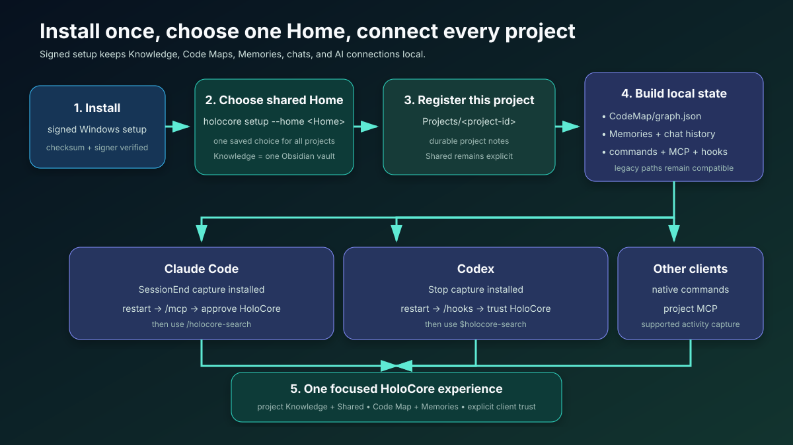

# Install and connect HoloCore v1



HoloCore uses one user-selected **HoloCore Home** for verified Knowledge, project Code Maps, Memories, chat history, generated AI connections, and the project registry.

## Recommended Windows installation

Download `holocore-setup-windows-x64.exe` from the latest signed GitHub release and double-click it. The native four-step setup application lets you:

1. Choose HoloCore Home and an optional first project.
2. Select detected Claude Code, Codex, Cursor, Gemini CLI, and OpenCode connections.
3. Choose whether to build the first Code Map and enable lightweight update checks.
4. Select an installed Ollama model or keep deterministic mode.
5. Review every resolved path and planned change before installation.

For managed deployment:

```powershell
irm https://github.com/HassanMahomed/HoloCore/releases/latest/download/install.ps1 | iex
```

The installer requires a schema-v2 release manifest, matching SHA-256 hashes, valid Authenticode signatures, and the exact signer thumbprint recorded in the manifest. It stops before replacing an existing installation when any verification fails.

## Developer installation

```powershell
uv tool install "git+https://github.com/HassanMahomed/HoloCore.git"
holocore setup-ui
```

Or initialize directly from a terminal:

```powershell
cd C:\Projects\MyProject
holocore setup --home "C:\Brains\HoloCore Home"
```

Later projects reuse the selected Home:

```powershell
cd C:\Projects\AnotherProject
holocore setup
```

## Current Home layout

```text
<Home>/
├── Knowledge/
│   ├── Projects/<project-id>/
│   ├── Shared/
│   └── system/index.md
├── Projects/<project-id>/
│   ├── CodeMap/graph.json
│   ├── CodeMap/atlas.html
│   ├── Runtime/
│   ├── Inbox/
│   ├── Sources/
│   └── world.json
├── Memories/
│   ├── animus.db
│   └── ChatHistory/<project-id>/
├── Connections/
└── worlds.json
```

`animus.db`, `atlas.html`, `world.json`, and `worlds.json` keep their historical filenames for data and link compatibility. Current interfaces call them Memories, Code Map, project configuration, and the project registry.

## Verify the installation

```powershell
holocore --version
holocore status
holocore connections
holocore paths
holocore projects
```

Restart connected AI clients after the first setup. Claude Code and Codex may request one-time approval for the local MCP server or capture hooks.

## Upgrade and regenerate integrations

```powershell
holocore update
holocore sync-all --regenerate
```

The regeneration command reconciles every registered project, writes schema-v6 project configuration, creates current `memory-*` and `code-map-*` integrations, and removes only obsolete HoloCore-generated legacy interfaces.

## Roll back

The Windows installer retains the previous engine and setup application as a matched pair. Exchange the installed and retained versions with:

```powershell
& "$env:LOCALAPPDATA\Programs\HoloCore\install.ps1" -Rollback
```

Rollback does not change HoloCore Home or project data.

## Uninstall the application

Use **Windows Settings → Apps → Installed apps → HoloCore → Uninstall**, select **Uninstall HoloCore** from the Start menu, or use the removal option inside HoloCore Setup. For terminal-managed installations, run:

```powershell
holocore uninstall
```

The native confirmation window explains exactly what will be removed. Uninstall removes executables, the cached installer, rollback binaries, the user PATH entry, both Start menu shortcuts, and the Windows Installed Apps registration. HoloCore Home, Knowledge, Code Maps, Memories, chat history, and registered project data are preserved.

See [Windows installation](windows-installation.md) for unattended options and [Troubleshooting](troubleshooting.md) for recovery guidance.
