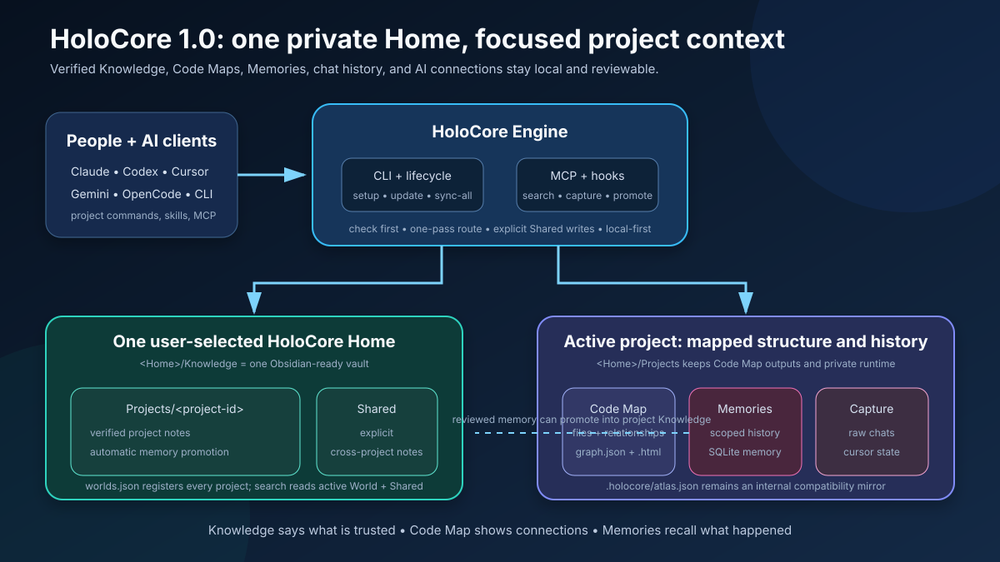
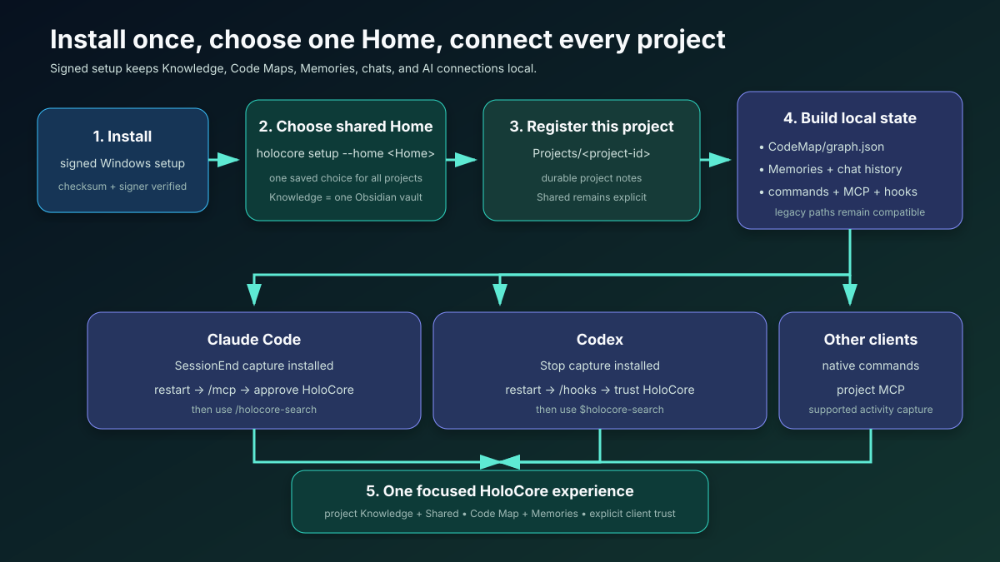
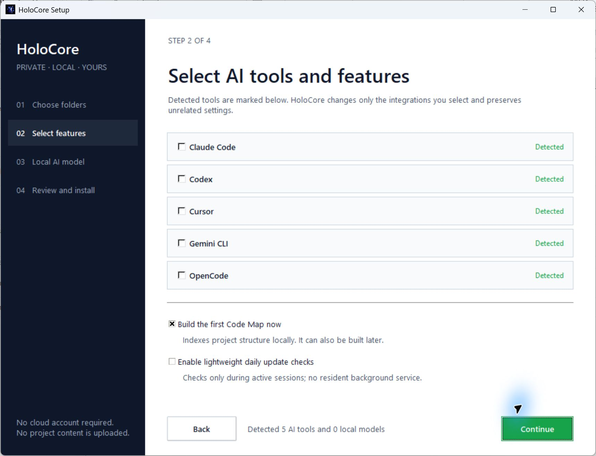
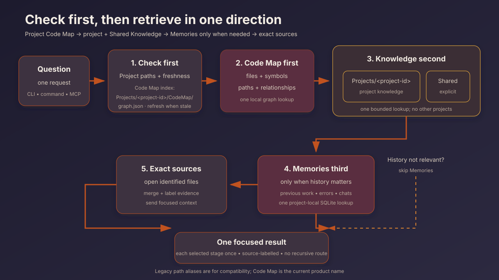
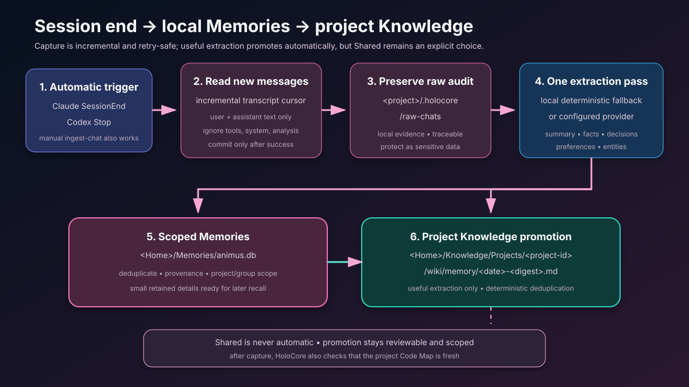
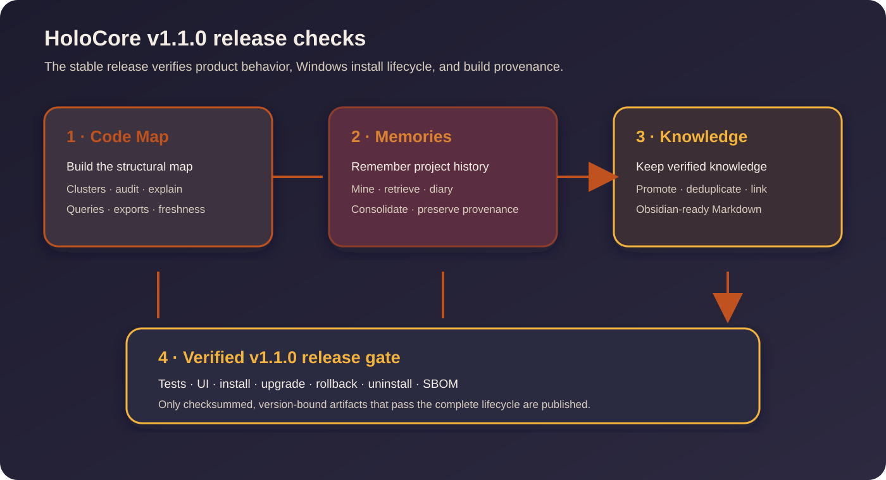

# HoloCore v1 visual guide

HoloCore keeps project context local, separates verified knowledge from remembered history, and gives every supported AI client the same bounded interfaces.

## One private Home

- **Knowledge** is the verified, human-readable Markdown vault.
- **Code Map** is rebuildable project structure: files, symbols, dependencies, paths, and groups.
- **Memories** retain useful prior work, decisions, errors, and conversation details with provenance.
- **Chat History** preserves the original local audit separately from refined Memories.
- **Connections** hold one generated integration bundle for supported AI clients.

Project retrieval stays scoped to the active project plus intentionally Shared Knowledge. HoloCore does not search every other project's private notes or history.

## Native setup

The Windows setup application has four pages:

1. Choose HoloCore Home and the first project.
2. Select detected AI clients and optional features.
3. Select an installed Ollama model or deterministic mode.
4. Review exact paths and planned changes, then install.

Nothing is applied before the review step. HoloCore preserves unrelated client configuration and never downloads a model runtime or model weights.

## One-direction retrieval

For each request HoloCore builds one route:

1. Check project readiness and Code Map freshness.
2. Use the Code Map once to identify relevant files and relationships.
3. Search project and Shared Knowledge once for verified rules and decisions.
4. Search scoped Memories once only when prior work or conversation history matters.
5. Open the exact source files identified by those checks.

The recursion guard prevents a HoloCore result from being routed back into HoloCore automatically.

## Conversation refinement and activity

Supported AI-client hooks record bounded activity metadata: run, action, status, tool name, timestamp, and affected file. They do not store prompts, full tool payloads, secrets, or authorization values in the activity ledger.

At safe transcript checkpoints HoloCore reads only new conversation content, preserves the raw local audit, extracts useful details once, deduplicates Memories, and promotes durable project details into Knowledge. Shared Knowledge always requires an explicit choice.

## Release verification

A stable tagged build must pass:

- the complete source test suite;
- built CLI and native Setup version checks;
- a native four-page UI smoke test at scaled DPI;
- Authenticode signing and signature verification;
- immutable manifest and SHA-256 verification;
- signed install, status, upgrade, rollback, uninstall, and data-preservation checks;
- reproducible CycloneDX SBOM generation and GitHub build-provenance attestation.

## Compatibility vocabulary

Older paths and API aliases remain supported:

| Legacy/internal name | Current product name |
|---|---|
| Archive | Knowledge |
| Atlas | Code Map |
| Animus | Memories |
| World | Project |
| Sector | Group or area |
| Signal | Item |
| Constellation | Code Map group |
| Deck | Memory collection |
| Chronicle | Memory history |

New documentation and generated integrations use the current product names. Compatibility aliases exist so existing installations and automation continue to work.
