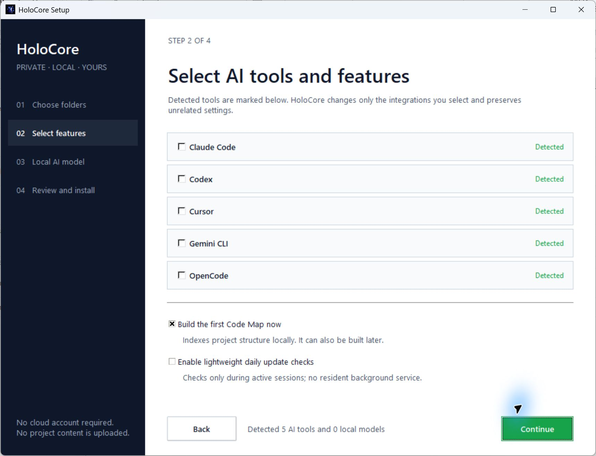

# Install HoloCore on Windows

## Fastest installation

Download `holocore-setup-windows-x64.exe` from the GitHub release and double-click it. This single executable carries and installs the HoloCore engine, adds it to the user PATH, creates the Start menu shortcut, and then opens the four-step setup window.

For managed or command-line deployment, open PowerShell and run:

```powershell
irm https://github.com/HassanMahomed/HoloCore/releases/latest/download/install.ps1 | iex
```

The installer:

1. Downloads the latest `holocore-windows-x64.exe` from the official GitHub release.
2. Downloads the immutable release manifest and requires matching SHA-256 checksums for both executables. If a future release is Authenticode signed, it also verifies that signer.
3. Installs HoloCore under `%LOCALAPPDATA%\Programs\HoloCore` and adds that folder to the user PATH.
4. Installs and opens the native **HoloCore Setup** Windows application.
5. Lets you choose the HoloCore Home and first project with a native folder picker.
6. Detects Claude Code, Codex, Cursor, Gemini CLI, OpenCode, Ollama, and installed Ollama models.
7. Lets you select client connections, the first Code Map, a local model, and lightweight update checks.
8. Shows the exact folders and planned changes before the final Apply action.

The setup application is a self-contained desktop interface. It does not load a web page, remote scripts, fonts, or assets. HoloCore does not install a model runtime or download models.



Open a new terminal after installation, then run:

```powershell
holocore status
```

The installer does not require Python. The standalone setup EXE, engine EXE, both checksums, and installer script are attached to each tagged [GitHub release](https://github.com/HassanMahomed/HoloCore/releases).

To install one exact release instead of the latest release:

```powershell
& .\install.ps1 -Version 1.0.0 -Yes
```

Installation stops before replacing any existing executable if the release manifest is unavailable, malformed, for another tag, or contains a checksum that does not match the downloaded artifact. Community releases are checksum-verified but may be unsigned, so Windows can show **Unknown publisher**. Confirm that the download URL is this repository, select **More info**, and then select **Run anyway**. If a release manifest declares signing, installation also stops for a missing, invalid, or mismatched signature.

## Non-interactive installation

Download the installer first when passing options:

```powershell
$installer = Join-Path $env:TEMP "holocore-install.ps1"
Invoke-WebRequest https://github.com/HassanMahomed/HoloCore/releases/latest/download/install.ps1 -OutFile $installer
& $installer -Yes -Project "C:\Projects\MyApp" -Home "D:\HoloCore" -EnableAutoUpdate
```

`-Yes` accepts connection prompts for every detected client. It does not silently connect clients that were not detected.
Use `-NoUI` for the original interactive terminal prompts without opening the desktop application. Reopen the visual setup at any time from **HoloCore Setup** in the Windows Start menu. Developer installs also provide `holocore-setup`.

## Connecting AI clients

Detection is read-only:

```powershell
holocore detect-clients
holocore --json detect-clients
```

To scan again and connect a project:

```powershell
cd C:\Projects\MyApp
holocore connect
```

HoloCore preserves unrelated client configuration. If an existing JSON or TOML file is invalid, HoloCore leaves it unchanged and reports the problem.

Claude Code and Codex may display a one-time trust or approval prompt after their project configuration changes. Review and approve the local HoloCore connection in that client.

## Upgrading

Run the same one-line installer again, or use:

```powershell
holocore update
```

Every upgrade rescans supported clients and reconciles registered projects. This connects clients installed after the original HoloCore setup, subject to the normal interactive approval prompt. Use `holocore update --yes` to approve every detected client non-interactively.

The installer keeps the previous executable as `holocore.exe.previous` for recovery.

To exchange the current and retained previous release without touching HoloCore Home:

```powershell
& "$env:LOCALAPPDATA\Programs\HoloCore\install.ps1" -Rollback
```

Each tagged release also publishes `holocore-sbom.cdx.json` and GitHub build provenance attestations alongside the executables, checksums, manifest, and installer.

HoloCore intends to use the free SignPath Foundation program for qualifying open-source projects. Until the project is accepted and its trusted-build integration is active, Windows releases remain clearly identified as unsigned community builds. See the [code signing policy](code-signing-policy.md).

## Lightweight automatic updates

```powershell
holocore auto-update --enable
holocore auto-update
holocore auto-update --check-now
holocore auto-update --disable
```

This is not a Windows Scheduled Task and does not run a resident process. When HoloCore records activity during a real AI session, it checks the GitHub release API at most once every 24 hours. If the computer is offline, the failure is quiet and HoloCore retries later. An enabled update is launched only after the session ends so the active AI client is not disrupted.

State is stored under `<HoloCore Home>\Runtime\auto-update.json`.

## Uninstalling the command

Run:

```powershell
holocore uninstall
```

For a native installation, uninstall from **Windows Settings → Apps → Installed apps**, the **Uninstall HoloCore** Start menu shortcut, HoloCore Setup, or `holocore uninstall`. The confirmation window removes the installed executables, cached installer, rollback files, user PATH entry, Start menu shortcuts, and Installed Apps registration. HoloCore Home and every project are intentionally preserved.
